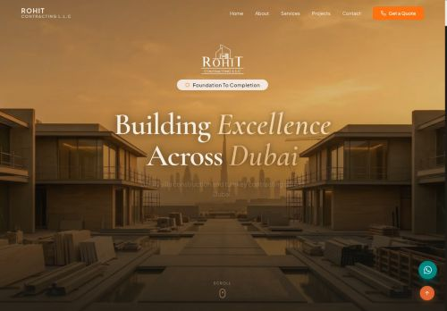

# Rohit Contracting L.L.C | Villa Construction Website

A client project for Rohit Contracting L.L.C, a villa construction and turnkey contracting company in Dubai. I designed and built the site with Next.js 16, TypeScript, Tailwind CSS v4 and Framer Motion, and I maintain it.

**Client:** Rohit Contracting L.L.C, Dubai  
**Work:** Design system, front-end and Next.js development  
**Live site:** [www.rohitcontracting.ae](https://www.rohitcontracting.ae)



## Architecture decisions

Animation-heavy marketing sites are usually rendered on the client, which leaves crawlers with almost nothing. This project prerenders a static version of every section and mounts the animated version after hydration.

- **Static HTML first, motion second.** Each section has a lightweight, animation-free twin that is prerendered. The Framer Motion version is imported on the client and replaces it. Crawlers and no-JS visitors get the full content.
- **Layout stability.** Entrance animations use transform and opacity, the hero image is preloaded with `next/image`, and media sits in sized containers. Measured CLS is 0.00.
- **Failure handling.** A React error boundary, timed loading-screen dismissal, a `<noscript>` rule that removes the overlay, and `loading` fallbacks on every dynamic import. A failed chunk or a JS-less visit does not leave a blank page.
- **Working contact form.** Posts to Web3Forms with client-side validation, per-field error messages, submission states and a reset on success.

## Lighthouse results

Lighthouse 13.6.0 on a production build (`next build` + `next start`), Chrome headless. Median of three runs per form factor, measured 18 Nov 2026.

| Category | Desktop | Mobile |
|---|---|---|
| Performance | 86 (84–90) | 69 (67–70) |
| Accessibility | 96 | 97 |
| Best Practices | 100 | 100 |
| SEO | 100 | 100 |
| Cumulative Layout Shift | 0.00 | 0.00 |

| Core Web Vital | Desktop | Mobile |
|---|---|---|
| First Contentful Paint | 0.3 s | 1.1–1.2 s |
| Largest Contentful Paint | 0.3 s | 1.1–1.2 s |
| Total Blocking Time | 180–270 ms | 1.4–1.9 s |
| Total page weight | ~933 KiB | ~898 KiB |

Performance is measured with Lighthouse's standard mobile emulation (4x CPU throttle). The remaining mobile cost is hydration of the motion layer, which I plan to reduce next.

## Build and size

| Signal | Value |
|---|---|
| Build | `next build` completes with 0 errors |
| Type checking | strict mode, 0 errors |
| Rendering | `/` and `/_not-found` statically prerendered |
| Production bundle | largest JS chunk 224 KB (Framer Motion) |
| Images | WebP/AVIF via `next/image`, hero asset 3168x1344 at 212 KB |
| Sections | 7 page sections, each with a static SSR twin |
| Project galleries | 7 villa projects, 12 photographs |
| SEO | Metadata API, Open Graph and Twitter cards, JSON-LD `LocalBusiness`, `robots.txt`, `sitemap.xml` |

## Tech stack

| Layer | Technology |
|---|---|
| Framework | Next.js 16.2.6 (App Router, Turbopack) |
| UI | React 19.2.4 |
| Language | TypeScript 5 (strict) |
| Styling | Tailwind CSS v4 (CSS-first config), custom CSS design tokens |
| Motion | Framer Motion 12 |
| Icons | lucide-react |
| Forms | Web3Forms API |
| Analytics | Vercel Analytics, Speed Insights, `web-vitals` reporter |
| Deployment | Vercel |

## Features

- Hero with scroll-linked parallax, spring-smoothed text fade and a responsive background image.
- 5-service grid, filterable 7-project gallery with a keyboard-navigable lightbox (arrow keys, Escape), milestone timeline, animated counters, reasons grid and a conversion CTA.
- Sticky, scroll-aware navbar with `IntersectionObserver` active-section highlighting, so there are no per-frame layout reads.
- Scroll progress bar, floating WhatsApp button and a custom loading screen with timed dismissal.
- Contact form with validation, loading, success and error states, plus a WhatsApp fallback.
- Semantic landmarks, labelled controls and sequentially ordered headings (Lighthouse Accessibility 96/97).
- Per-page metadata, social cards, structured data for a local business, sitemap and robots directives.
- Design system with a warm-earth OKLCH palette, Cormorant Garamond display type and Plus Jakarta Sans, documented in [`docs/DESIGN.md`](docs/DESIGN.md).

## Getting started

```bash
# 1. Install dependencies
npm install

# 2. Run the development server
npm run dev
# http://localhost:3000

# 3. Production build and preview
npm run build
npm start
```

### Scripts

| Command | Description |
|---|---|
| `npm run dev` | Start the dev server |
| `npm run build` | Production build |
| `npm start` | Serve the production build |
| `npm run lint` | Run ESLint |

## Project structure

```
src/
├── app/
│   ├── layout.tsx        # Fonts, metadata, JSON-LD, error boundary, analytics
│   ├── page.tsx          # Server entry, renders MainContent
│   └── globals.css       # Tailwind v4 theme and custom utilities
├── components/
│   ├── MainContent.tsx   # Client shell: dynamic (ssr:false) animated sections
│   ├── *Static.tsx       # SSR-safe twins of each section (SEO + no-JS)
│   ├── *Section.tsx      # Framer Motion versions mounted on the client
│   ├── Navbar.tsx / Footer.tsx / WhatsAppButton.tsx
│   └── ErrorBoundary.tsx / WebVitalsReporter.tsx
├── lib/utils.ts
└── styles/theme.css      # Design tokens (OKLCH), light/dark foundations
public/
├── projects/             # Optimised project photography
├── robots.txt / sitemap.xml
└── bg.webp               # Hero image
docs/
├── DESIGN.md             # Design system and redesign brief
└── preview-desktop.png   # README screenshot
```

### Rendering strategy

```
Request -> prerendered HTML (static section twins, full content)
        -> hydration
        -> dynamic import of the animated section (ssr: false)
        -> static twin swaps to the live, interactive section
```

This is what keeps Lighthouse SEO at 100 while the page still animates.

## Performance and accessibility notes

- Fonts are self-hosted through `next/font`, so there are no render-blocking third-party requests.
- Images are served as AVIF/WebP with responsive `sizes`, and the hero image is priority-loaded.
- Scroll listeners are passive. Active-nav tracking uses `IntersectionObserver` instead of per-frame `getBoundingClientRect()` calls.
- Verified with Lighthouse, including Accessibility (96/97) and Best Practices (100).

**Known item:** two CTA buttons use white text on the brand orange (3.08:1), which keeps accessibility at 96/97 instead of 100. Fixing it means dark text on orange or a darker orange, so I left the palette choice to the client.

## Notes

- The contact form uses Web3Forms. The access key is intentionally public because it is a client-side form endpoint.
- The site is a single-page marketing site with no database or CMS.
- There is no test suite yet. I verify with `next build` and Lighthouse.

Built by [Hardeep Shetty](https://github.com/Dashetty).
